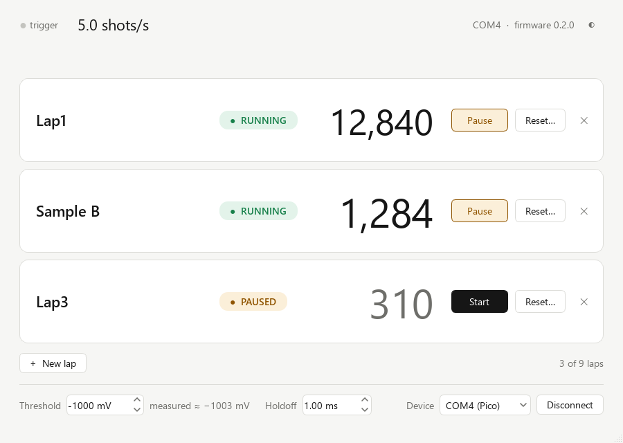

# Laser Shot Counter app

Desktop app for the counter box. It shows shots per second and up to nine **laps**: separate shot counts that run
side by side, each with its own name, Start/Pause, Reset and Delete. It also sets the trigger threshold. Talks to the
box over USB serial (see [docs/protocol.md](../docs/protocol.md)), or to a built-in simulator so you can try it with
no hardware.



## Run it

From the repo folder (Windows, Python 3.10+):

```bash
python -m venv .venv
```

```bash
.venv/Scripts/python -m pip install -e "app[dev]"
```

```bash
.venv/Scripts/python -m laser_counter --simulate
```

Without `--simulate` it reconnects to the last box used (or the only Pico plugged in). You can also pick
the device in the bottom-right corner, or pass `--port COM5`.

## Controls

| Control | What it does |
|---|---|
| **+ New lap** | Add a lap that counts from 0, starting right away, while the other laps carry on. Up to 9 laps. |
| Lap **name** | Click it to rename the lap (up to 24 characters). Enter keeps the new name, Escape undoes it. New laps are called Lap1, Lap2, … |
| Lap **Start / Pause** | Start or pause just this lap. Paused laps show their count in grey. If every lap is paused while shots are arriving, a banner says so. |
| Lap **Reset…** | Set just this lap to 0, after a confirmation |
| Lap **✕** | Delete the lap (asks first if it has counted anything). The last lap can't be deleted. |
| **Threshold** | A shot counts when the photodiode signal dips below this, e.g. −400 mV (the same as the PI-MAX4 trigger). The box's own measurement is shown next to it. |
| **Holdoff** | Dead time after each shot, so ringing can't be counted twice. Default 1 ms. |
| **trigger** dot | Flashes on every detected shot |
| **◐** | Light / dark theme |

Lap controls work while the box is connected; names and Delete also work while it isn't.

**Laps are kept when you close the app**: names, counts, and which are running. The box itself keeps counting while
the app is closed, so the next time the app connects, shots fired in the meantime are added to the laps that were
running. That only works if the box stayed plugged in: unplugging it resets its own total, and the laps then carry on
from their saved counts. Test pulses sent from a terminal count too, so end a bench test with `PAUSE` and `RESET`
(as the build guide does) and they won't be added.

Laps made with the **Simulator** are just for practice. They start fresh, aren't saved, and your real laps come back
when you disconnect it.

Settings (threshold, holdoff, last device, theme) are remembered between runs too.

## Make the .exe (for PCs without Python)

```bash
.venv/Scripts/python -m pip install -e "app[dev]"
```

```bash
.venv/Scripts/python app/build_exe.py
```

This produces **`dist/LaserShotCounter.exe`** (~37 MB): one file with Python, Qt and the app inside. Copy it to any
64-bit Windows 10/11 PC (USB stick, network share) and double-click it. Nothing needs installing.

- The first launch takes a few seconds while it unpacks itself.
- Windows may show *"Windows protected your PC"* because the file isn't code-signed. Click **More info → Run anyway**.
  On a managed lab PC, IT may need to allow it.
- Settings (threshold, holdoff, last device, theme) are saved per Windows user on each PC.
- `LaserShotCounter.exe --simulate` runs it with the pretend laser (make a desktop shortcut with that argument).
- Windows only. A Mac or Linux version would need to be built on that system.

Rebuild after any change to the app. The `dist/` and `build/` folders aren't committed to git.

## Tests

```bash
.venv/Scripts/python -m pytest app
```
