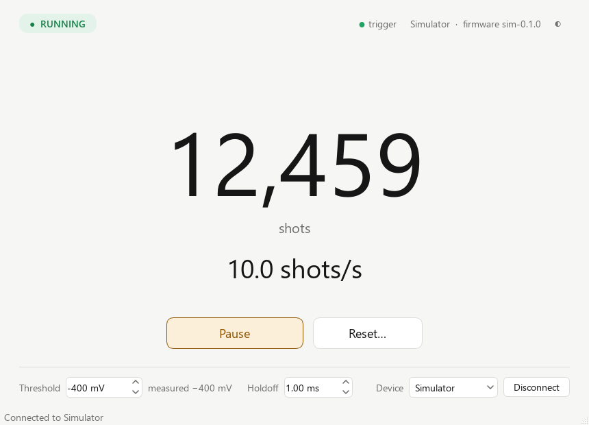

# Laser Shot Counter app

Desktop app for the counter box. It shows the live shot count and shots per second, has Start/Pause and
Reset buttons, and sets the trigger threshold. Talks to the box over USB serial (see
[docs/protocol.md](../docs/protocol.md)), or to a built-in simulator so you can try it with no hardware.



## Run it

From the repo folder (Windows, Python 3.10+):

```bash
python -m venv .venv
```

```bash
.venv/Scripts/python -m pip install -e "app[dev]"
```

```bash
.venv/Scripts/python -m laser_counter --simulate
```

Without `--simulate` it reconnects to the last box used (or the only Pico plugged in). You can also pick
the device in the bottom-right corner, or pass `--port COM5`.

## Controls

| Control | What it does |
|---|---|
| **Start / Pause** (Space) | Start or pause adding shots to the count. While paused the box still detects shots, and a banner reminds you they aren't being counted. |
| **Reset…** (R) | Set the count to 0, after a confirmation |
| **Threshold** | A shot counts when the photodiode signal dips below this, e.g. −400 mV (the same as the PI-MAX4 trigger). The box's own measurement is shown next to it. |
| **Holdoff** | Dead time after each shot, so ringing can't be counted twice. Default 1 ms. |
| **trigger** dot | Flashes on every detected shot |
| **◐** | Light / dark theme |

Settings (threshold, holdoff, last device, theme) are remembered between runs.

## Tests

```bash
.venv/Scripts/python -m pytest app
```
