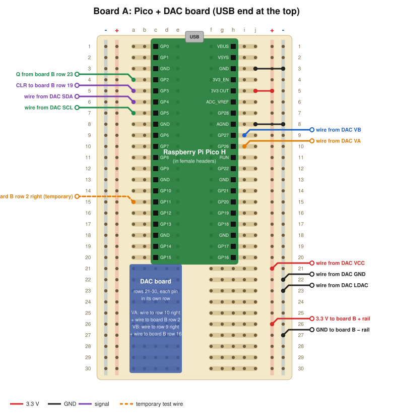
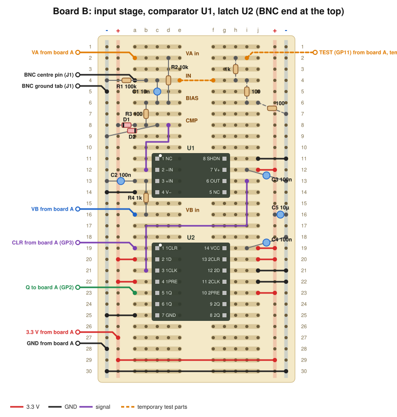
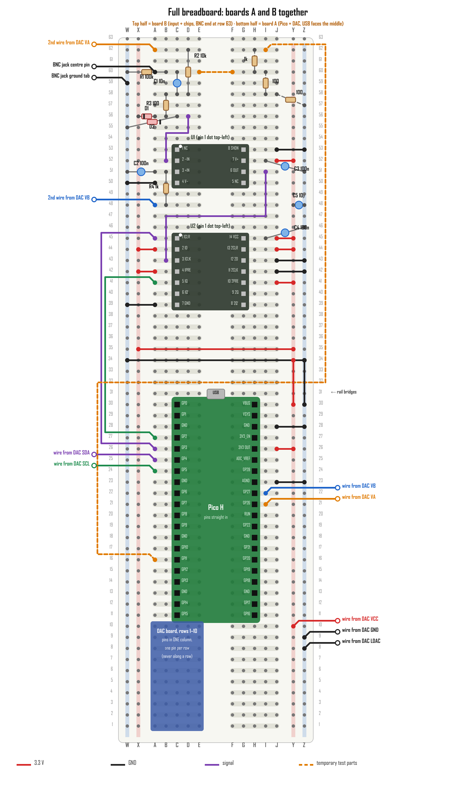

# Phase 3 build guide: the counter box

You'll build two small boards, test each one before moving on, then test the whole circuit using the Pico itself
as a pretend laser, and finally put it all in the box. No function generator is needed. Expect one or two afternoons.

| Stage | What | Test at the end |
|---|---|---|
| 1 | Solder the two chips onto their adapter boards | Multimeter continuity check |
| 2 | Board A: Pico socket + DAC board | DAC makes 1.500 V and 1.100 V |
| 3 | Board B: input stage, comparator, latch | Resistance and diode checks, no power yet |
| 4 | Connect the boards, power up | Voltages at each node |
| 5 | Pico-as-laser test (temporary parts) | 1000 pulses in → count of exactly 1000; threshold sweep |
| 6 | Into the box | Quiet when nothing is connected |

Every connection here comes from [hardware.md](hardware.md). If the guide and that file ever disagree, stop and ask.

---

## Before you start

### Tools and materials (all on hand)
- Fine-tip soldering iron, solder (thinner is easier), **flux pen**, **solder wick**, tweezers, flush cutters, wire strippers, magnifier or phone camera zoom
- Multimeter. The **Keithley 2000** is ideal for the voltage checks; any handheld with continuity beep and diode mode is fine for the rest.
- 22 AWG solid hookup wire in a few colors: **red = 3.3 V, black = ground**, other colors for signals
- Isopropyl alcohol and a small brush or cotton swab to clean flux off (optional)
- From the order: both Perma-Proto boards, both Picos, TLV3501 ×2, SN74LVC74A ×2, PA0001 ×2, PA0003 ×2, the
  40-pin male header strips, the two 20-pin female headers, the DAC board, BAT41 ×4, the resistors and capacitors, the BNC jack,
  the USB panel cable, the nylon standoff kit

### Static and safety
- Touch something grounded (a metal desk frame or the scope's case) before handling the chips. Keep them in their packaging until needed.
- Never solder with the Pico plugged into USB.
- If anything gets hot, or the Pico disconnects the moment you plug it in, unplug immediately (it's a short) and see Troubleshooting.

### How to read the board drawings



- **Rows** are numbered 1–30. **Columns** are a–e (left half) and f–j (right half).
- **The five holes a–e of one row are connected to each other** (a "strip"), and so are f–j. The left and right halves are
  *not* connected. In this guide, "**L5**" means row 5, left half (any of holes a–e), and "**R12**" means row 12, right half.
- The long **rails** run down each side: **+** (3.3 V) and **−** (ground). "**+L**" is the left + rail, "**−R**" the right − rail, and so on.
  The drawings put − on the outside edge. **Go by the + and − printed on your board**, not by position.
- **Insulated wires** can cross over anything; only their stripped ends make contact.
- **Bare component leads** must not touch anything they're not meant to. If a lead crosses a rail, slide a short piece of
  stripped wire insulation over it as a sleeve.
- Top of each drawing = the end facing the box's end cap: **USB end for board A, BNC end for board B**.

### Building on a solderless breadboard first (while the Perma-Protos are on backorder)
A full-size solderless breadboard (63 rows, columns A–J, rails W X on the left and Y Z on the right) can hold both boards.
Stages 2–5 are built and tested on it with no board soldering, then moved onto the Perma-Protos for the box.



**Follow this drawing, not the Perma-Proto ones, when building on the breadboard.** The breadboard numbers its rows
**bottom to top** while the Perma-Proto drawings count top to bottom. Copying row numbers straight across would mirror the
layout, and a mirrored chip can't be placed: its pins would end up in the wrong rows. The drawing above lays both
Perma-Proto layouts onto the breadboard exactly as drawn.

- **Hold the breadboard like this:** row 1 nearest you, rails W and X on the **left**. Same as the photo of yours.
- **Top half, rows 34–63: board B** (input + chips, BNC end at row 63). **Bottom half, rows 1–30: board A** (Pico + DAC).
  Converting a Perma-Proto row: board B → **64 − row**, board A → **31 − row**. Columns stay the same letters.
- **Rails:** W and Z are ground (−), X and Y are 3.3 V (+). Mark them with tape. The two short **rail bridges** (Y30–Y34, Z30–Z34)
  join the halves in case your breadboard splits its rails in the middle. Fit them either way.
- **Pico H:** plugs straight in, columns **C and H, rows 11–30**, **USB end toward the middle** (row 31). No female headers needed.
- **Chips:** pin-1 dot at the **top-left**. **U1** pins 1–4 in C53→C50, pins 8–5 in G53→G50. **U2** pins 1–7 in C45→C39, pins 14–8 in G45→G39.
- **DAC board:** rows 1–10, left half, with **its pins in one column, one pin per row, never along a single row** (that would
  short all its pins together). Keep its circuit board clear of the Pico's; if they touch, turn the DAC so its body points away.
- **Skip W1 and W2** (3.3 V and ground between the boards); the rails carry them. The other board-to-board wires are drawn in.
- **The adapters and DAC board need their header pins soldered on** (Stage 3a). Use the breadboard as the jig: pins in the breadboard,
  part on top, quick joints from above. **Nothing else is soldered**; every wire and part just pushes in.
- **Keep wires short and C3 right at the comparator.** If the comparator chatters in Stage 5, suspect the breadboard; the soldered
  Perma-Proto build will be cleaner.
- **Fit:** the breadboard (~6.5") fits the 8¾" box (3686K72).

### Soldering basics (30-second version)
1. Iron at about 330–350 °C. Wipe the tip, then melt a little solder on it ("tinning").
2. Touch the tip to **both** the pad and the lead for about a second, then feed solder into the joint, not onto the iron. Pull the solder away, then the iron.
3. A good joint is a shiny little cone. A ball sitting on top means the pad wasn't hot enough; reheat it with a touch of flux.
4. Trim leads after soldering. Wires: strip about 5 mm, push through, solder, trim.
5. Too much solder or a bridge between two pins: put flux on it, press solder wick onto it with the iron, and lift both together.

---

## Stage 1: Solder the chips onto their adapters

Do **the latch (SN74LVC74A, 14 pins) first**. It's the cheaper chip, and you have a spare of each.

| Chip | Pins | Adapter |
|---|---|---|
| SN74LVC74A (latch, U2) | 14 | PA0003 (SOIC-14) |
| TLV3501 (comparator, U1) | 8 | PA0001 (SOIC-8) |

1. **Find pin 1 on the chip:** a small dot or dimple in one corner, or a bevelled long edge (pin 1 is at the bevelled side's left end).
   **Find pin 1 on the adapter:** a dot, a "1", or a square pad. They must match.
2. Put a little flux on the adapter's pads. Melt a small bump of solder onto **one corner pad only**.
3. Hold the chip in place with tweezers, pins centred on their pads, pin 1 on pin 1. Touch the iron to that corner pin so
   the bump melts and grabs it. Let go and check under magnification that **every** pin sits on its pad. If not, reheat that one pin and nudge the chip.
4. Solder the **opposite corner** pin. Now it can't move.
5. Solder each remaining pin: flux, touch the iron to the pin and pad, and feed a *tiny* amount of solder.
6. Inspect every gap between neighboring pins. Any bridge? Flux + wick (basics step 5).
7. **Continuity check** (multimeter beep mode): touch one probe to each chip pin's top and the other to the matching
   adapter pin hole. It should beep. Then check that **neighboring** pins do **not** beep together.

The adapter's header pins get soldered in Stage 3, when the adapter goes onto board B. Snap the 40-pin male strip into
**two pieces of 7** (for the PA0003) and **two pieces of 4** (for the PA0001) now.

---

## Stage 2: Board A (Pico + DAC board)

### 2a. The Pico socket
1. Plug the **Pico H into both 20-pin female headers** (they hold each other straight).
2. Set that whole stack onto board A with the female headers' pins in **columns c and h, rows 1–20**, and the **Pico's USB end at row 1**.
3. Flip the board over, holding the stack in place, and solder all 40 female-header pins from underneath.
4. Pull the Pico out again. It stays out until 2d.

### 2b. The DAC board
1. If the DAC board's pins aren't soldered on yet, solder its header strip (short pins into the DAC board, long pins down).
   If no strip came with it, use a piece of the male strip.
2. Place it in the **left half, rows 21–30**, so that **each of its pins is in a different row**.
3. Write down which row each pin landed in. You'll use this table for the next wires:

| DAC pin | Row on board A |
|---|---|
| VCC | |
| GND | |
| SCL | |
| SDA | |
| LDAC | |
| VA | |
| VB | |

Solder the DAC board's pins from underneath. RDY, VC and VD stay unconnected.

### 2c. Wires on board A
"DAC SDA row" means the row you wrote in the table. Use any free hole in that row's strip.

| # | From | To | Color | Why |
|---|---|---|---|---|
| A1 | R5 (hole j) | +R rail | red | Pico 3V3 OUT → + rail |
| A2 | R3 (hole j) | −R rail | black | Pico GND → − rail |
| A3 | R8 (hole j) | −R rail | black | Pico AGND → − rail |
| A4 | DAC VCC row | +R rail | red | power the DAC |
| A5 | DAC GND row | −R rail | black | |
| A6 | DAC LDAC row | −R rail | black | outputs update immediately |
| A7 | DAC SDA row | L6 (hole a) | any | SDA → GP4 |
| A8 | DAC SCL row | L7 (hole a) | any | SCL → GP5 |
| A9 | DAC VA row | R10 (hole i) | orange | VA → GP26 (readback) |
| A10 | DAC VB row | R9 (hole i) | blue | VB → GP27 (readback) |

⚠ SDA and SCL swapped is the most common mistake. Double-check A7 and A8.

### 2d. Plug the Pico back in
USB end toward row 1. Every pin should be in the socket, none hanging off the end.

---

## Stage 2 test: board A on its own

1. **Update the firmware to 0.2.0**, which adds the `PULSE` command used in Stage 5. On the laptop (in `$HOME\lc`), put the
   new `main.py` there (USB stick, or https://raw.githubusercontent.com/tjsachs05-droid/laser-counter-via-photodiode/main/firmware/main.py),
   plug the Pico in, then:
   ```powershell
   .\.venv\Scripts\python.exe -m mpremote cp main.py :main.py
   ```
   ```powershell
   .\.venv\Scripts\python.exe -m mpremote reset
   ```
2. Open the terminal (`.\.venv\Scripts\python.exe -m serial.tools.miniterm --echo --eol LF COM5 115200`, with your COM number). The `STAT` lines should now say:
   - `dac=1` (the DAC answered)
   - `bias=` about **1500** and `thr_meas=` about **−400** (the Pico's own rough readback, ±20 mV is fine)
   - `ID?` should answer `fw=0.2.0`
3. **Keithley 2000** on DC volts. Black lead on ground (any −R rail hole), red lead on:
   - the DAC **VA** row → **1.500 V** (typically within a few mV; up to ±20 mV is still within the DAC's spec)
   - the DAC **VB** row → **1.100 V** (same tolerance)
   - Write both readings down. The threshold the box really uses is VB − VA, which is −400 mV when everything is ideal.
4. Type `THR -250` → VB should become **1.250 V**. `THR -700` → **0.800 V**. Then `THR -400` to go back.
   VB is the threshold; the comparator compares the signal against it. Your multimeter just watched you move it.
5. Leave the terminal (Ctrl + ]) and unplug the USB.

If `dac=0`: see Troubleshooting.

---

## Stage 3: Board B (input stage, comparator, latch)

### 3a. Mount the two adapters
Your adapters (PA0001, PA0003, the standard size, not the "C" compact ones) almost certainly have their two pin rows
**0.6" apart**, so their pins go in **columns c and g**, as drawn. Check before soldering: hold an adapter over the board
with one pin row over column c. The other row should line up with column g. (If instead the rows are only 0.3" apart,
fitting e and f across the centre gap, use **e and f**. All the connections below still work, because they only use holes
**a, b** on the left and **i, j** on the right.)

1. Push the two **7-pin** strips (long ends down) into board B **rows 19–25**, one strip in **column c**, one in **column g**.
   Set the latch adapter (PA0003) on top with **pin 1 at row 19, left side**. Solder the pins on top of the adapter, then flip the
   board and solder them underneath.
2. Same for the comparator adapter (PA0001): two **4-pin** strips in **rows 11–14**, columns c and g, **pin 1 at row 11, left side**.
3. The adapter boards cover holes c–g in their rows. That's expected; nothing else goes in those holes.

Pin layout once mounted (pin 1 top-left, numbers go down the left and back up the right):

| Row | Left half | Right half |
|---|---|---|
| 11 | U1 pin 1 (NC) | U1 pin 8 (SHDN) |
| 12 | U1 pin 2 (−IN) | U1 pin 7 (V+) |
| 13 | U1 pin 3 (+IN) | U1 pin 6 (OUT) |
| 14 | U1 pin 4 (V−) | U1 pin 5 (NC) |
| 19 | U2 pin 1 (1CLR) | U2 pin 14 (VCC) |
| 20 | U2 pin 2 (1D) | U2 pin 13 (2CLR) |
| 21 | U2 pin 3 (1CLK) | U2 pin 12 (2D) |
| 22 | U2 pin 4 (1PRE) | U2 pin 11 (2CLK) |
| 23 | U2 pin 5 (1Q) | U2 pin 10 (2PRE) |
| 24 | U2 pin 6 (1Q̄) | U2 pin 9 (2Q) |
| 25 | U2 pin 7 (GND) | U2 pin 8 (2Q̄) |

### 3b. Identify the small parts
| Part | Looks like | Marking |
|---|---|---|
| 100 kΩ (R1) | resistor | brown black **yellow** gold |
| 10 kΩ (R2) | resistor | brown black **orange** gold |
| 1 kΩ (R4) | resistor | brown black **red** gold |
| 100 Ω (R3) | resistor | brown black **brown** gold |
| 10 nF (C1) | small ceramic | **103** |
| 100 nF (C2, C3, C4) | small ceramic | **104** |
| 10 µF (C5) | ceramic | **106** |
| BAT41 (D1, D2) | small glass diode | **black band = cathode** (the "stripe" end) |

If a marking is hard to read, measure the resistor with the multimeter before soldering it.

### 3c. Wires and parts on board B
Do the wires and resistors first, then the diodes, then the capacitors. Every hole below matches the drawing.

**Ties for the latch and comparator** (short jumpers)

| # | From | To | Color | Why |
|---|---|---|---|---|
| B1 | L14 (a) | −L | black | U1 pin 4 V− = ground |
| B2 | R11 (j) | −R | black | **U1 pin 8 SHDN = ground. Without this the comparator is switched off.** |
| B3 | R12 (j) | +R | red | U1 pin 7 V+ = 3.3 V |
| B4 | L20 (a) | +L | red | U2 1D = 1 |
| B5 | L22 (a) | +L | red | U2 1PRE off |
| B6 | L25 (a) | −L | black | U2 GND |
| B7 | R19 (j) | +R | red | U2 VCC |
| B8 | R20 (j) | +R | red | spare flip-flop 2CLR off |
| B9 | R21 (j) | −R | black | spare 2D |
| B10 | R22 (j) | −R | black | spare 2CLK |
| B11 | R23 (j) | +R | red | spare 2PRE off |
| B12 | +L row 29 | +R row 29 | red | join the two + rails |
| B13 | −L row 30 | −R row 30 | black | join the two − rails |

**Signal wires**

| # | From | To | Why |
|---|---|---|---|
| B14 | L8 (d) | L12 (b) | comparator input (CMP) → U1 pin 2 |
| B15 | R13 (i) | L21 (b) | U1 OUT → U2 1CLK (route it around, any path) |

**Parts**

| Part | Lead 1 | Lead 2 | Notes |
|---|---|---|---|
| R1 100 kΩ | L4 (b) | −L | input bleed |
| R2 10 kΩ | L2 (d) | L6 (d) | bias, lies over d3–d5 |
| R3 100 Ω | L6 (b) | L8 (b) | |
| R4 1 kΩ | L16 (b) | L13 (b) | threshold filter |
| D1 BAT41 | L8 (a) | **+L, stripe end** | clamp high |
| D2 BAT41 | **−L** | **L8 (c), stripe end** | clamp low. **The stripe goes on L8, not on the rail.** |
| C1 10 nF (103) | L4 (c) | L6 (c) | AC coupling |
| C2 100 nF (104) | L13 (a) | −L | holds the threshold steady |
| C3 100 nF (104) | R12 (i) | −R | comparator power, **as close to the chip as you can** |
| C4 100 nF (104) | R19 (i) | −R | latch power |
| C5 10 µF (106) | +R | −R | around row 16 |

The BNC jack (J1) isn't fitted yet; that happens in Stage 6.

---

## Stage 3 check: before any power

USB unplugged, boards **not** connected yet. Multimeter on board B only.

| Check | Probes | Expect |
|---|---|---|
| No short | + rail to − rail (Ω) | **Not** near 0. It may start low and climb as C5 charges; anything above ~1 kΩ is fine. |
| SHDN tied | U1 pin 8 (R11) to − rail (beep) | beeps |
| Comparator power | U1 pin 7 (R12) to + rail; U1 pin 4 (L14) to − rail | both beep |
| Latch ties | U2 rows L20, L22, R19, R20, R23 to + rail | all beep |
| Latch ties | U2 rows L25, R21, R22 to − rail | all beep |
| R1 | L4 to − rail | ≈ 100 kΩ |
| R2 | L2 to L6 | ≈ 10 kΩ |
| R3 | L6 to L8 | ≈ 100 Ω |
| R4 | L16 to L13 | ≈ 1 kΩ |
| D2 direction | diode mode: red on − rail, black on L8 | ≈ 0.2–0.4 V. Swap the probes → noticeably higher (OL, or above ~1 V; the chips can give a reading here). |
| D1 direction | diode mode: red on L8, black on + rail | ≈ 0.2–0.4 V. Swap → noticeably higher. |

If a diode reads ≈ 0.2–0.4 V the *wrong* way round and high the right way, it's in backwards. Fix it before going on.

Anything that doesn't match: fix it now. It's much easier than after power-up.

---

## Stage 4: Connect the boards and power up

Six wires, each about 15 cm (you can shorten them when it all goes in the box).

| # | Board A | Board B | Color |
|---|---|---|---|
| W1 | +R, row 26 | +L, row 27 | red (3.3 V) |
| W2 | −R, row 27 | −L, row 28 | black (GND) |
| W3 | DAC **VA** row (a free hole) | L2 (a) | orange |
| W4 | DAC **VB** row (a free hole) | L16 (a) | blue |
| W5 | L5 (a), GP3 | L19 (a), latch CLR | any |
| W6 | L4 (a), GP2 | L23 (a), latch Q | any |

Plug in the USB and open the terminal.
- `STAT` lines: `dac=1`, `bias≈1500`, `thr_meas≈-400`
- **No `EVT` lines.** Nothing is connected to the input, so nothing should be detected. A steady stream of `EVT`
  lines means the comparator is oscillating; see Troubleshooting.

**Keithley 2000**, black lead on ground:

| Probe | Node | Expect |
|---|---|---|
| + rail | 3.3 V | 3.25–3.35 V |
| L6 | BIAS | 1.500 V |
| L8 | CMP | 1.500 V |
| L13 | THR | 1.100 V |
| R13 | U1 OUT | ≈ 0 V |
| L19 | latch CLR | ≈ 3.3 V |
| L23 | latch Q | ≈ 0 V |

---

## Stage 5: The Pico pretends to be the laser

The Pico can make short **negative** pulses on GP11 (`PULSE` command). A 1 kΩ / 200 Ω divider scales them to about
**−0.55 V**, close to your photodiode's pulse, and feeds them into the input. These are the **orange dashed** parts on the
drawings, built from spare resistors. They're **temporary**.

### 5a. Build the test divider (USB unplugged)
| # | From | To | |
|---|---|---|---|
| T1 | board A L15 (a), GP11 | board B R2 (i) | wire |
| T2 | 1 kΩ (brown black red) | R2 (h) → R4 (h) | |
| T3 | 100 Ω (brown black brown) | R4 (i) → R6 (i) | |
| T4 | 100 Ω | R6 (j) → −R | sleeve the lead where it crosses + |
| T5 | wire | R4 (f) → L4 (e) | this is the link into the input. **It must come out afterwards.** |

### 5b. Tests
Plug in the USB and open the terminal. Type the commands and press Enter after each.

1. **Pulses are seen:** `PULSE 5 50` → `OK PULSE 5 48 0` or `OK PULSE 5 53 0` (the width is rounded to the Pico's
   clock steps, 6.7–8 ns depending on its clock speed).
   `EVT … counted=0` lines appear 5 times a second (the box starts paused). The LED flickers.
2. **Counting:** `START` → `count` climbs 1, 2, 3… → `PAUSE` → stops.
3. **Exact count, 50 ns pulses:** `PULSE 0` first (otherwise the 5 Hz pulses from step 1 add extra counts), then `RESET`, `START`, `PULSE 100 50 1000`. After about 10 s the pulses stop on their own.
   `STATUS?` → **`count=1000` exactly.**
4. **Exact count, shortest pulses (about 15 ns):** `RESET`, then `PULSE 100 16 1000` → after 10 s, **`count=1000`.**
   This shows the comparator and latch catch pulses shorter than your laser's.
5. **Threshold sweep:** `PULSE 20 50`, then step the threshold down. Watch whether `EVT` lines keep coming:
   `THR -300` → yes · `THR -400` → yes · `THR -450` → yes · `THR -500` → probably · `THR -550` → borderline · `THR -650` → **none**.
   Note the threshold where they stop: that's the test pulse's height as the box sees it (about −0.5 V).
   That clean on/off switch is the comparator doing its job. Put it back with `THR -400`.
6. **Holdoff:** `PULSE 500 50`, `START`, and watch the count climb about 500 per second. `HOLD 3000` → it drops to
   about **250 per second** (every other pulse lands in the 3 ms deaf period). `HOLD 1000` puts it back.
7. Stop the pulses: `PULSE 0`.
8. **The app:** leave the terminal (Ctrl + ]). Start `PULSE 5 50` again first if you want something to count, then open
   `LaserShotCounter.exe`. Start, Pause, Reset and the threshold box should all behave like the commands above.

Optional, with the scope: probe **L6 (BIAS)** and you'll see 1.5 V dipping to about 0.95 V on each pulse. Probe **R13 (U1 OUT)**
and you'll see a 3.3 V spike on each one.

### 5c. Remove the test parts (USB unplugged)
- Remove **T5** (the R4 → L4 link). **Required:** left in, it would put 200 Ω on the camera's trigger line.
- Remove **T1** (the GP11 wire). GP11 must stay unconnected in the finished box.
- The 1 kΩ and two 100 Ω can stay; once T1 and T5 are gone, they're connected to nothing that matters.

---

## Stage 6: Into the box

### 6a. Plan the layout
- **Board B** goes at the **BNC end** (its row 1 toward that end cap). **Board A** goes at the **USB end** (Pico's USB toward that end cap).
- Both boards sit across the box, with their 3.2" length spanning the box's width.
- Check the BNC end cap's thickness: the jack fits panels up to about **3.2 mm (1/8")**.

### 6b. BNC hole (9.7 mm "D" hole, see [BOM.md](../BOM.md))
1. Mark the centre of the end cap, keeping it away from the screw holes. Drill a small pilot hole, then **3/8" (9.5 mm)**.
2. Round-file until the jack's threads just pass through.
3. File **one straight flat** so the jack drops in and can't turn (the flat is 8.85 mm from the far side of the hole).
4. Deburr. Practicing on scrap aluminum first is worth it.

### 6c. USB opening
1. Hold the panel-mount USB connector against the other end cap and mark its two screw holes (**17.3 mm apart**) and the outline of the socket body.
2. Drill two 3.2 mm holes for the M3 screws.
3. Make the socket opening: drill a row of small holes inside the outline, then file it to shape until the socket fits.
4. Plug the extension's **male** end into the Pico and screw the **female** end into the end cap. (The screws can also go in from behind if the panel is thick.)

### 6d. Mount the boards
1. Each Perma-Proto has two mounting holes 2.9" apart. Hold each board in position and mark its holes on the inside of the box.
2. Drill about **2.7–3 mm** holes. Fit **M2.5 nylon standoffs** from the kit, screwed through from outside, then the board, then nylon nuts.
   **No solder joint may touch the aluminum.** Check with the boards in place.
3. Shorten the board-to-board wires (W1–W6) if they're in the way.

### 6e. BNC jack
1. Twist together two ~8 cm wires (one signal, one black).
2. Solder the signal wire to the jack's **centre solder cup** and the black wire to its **ground tab** (or the separate solder tag under the nut).
3. Push the jack through from **outside**. Inside, add the lock washer and nut and tighten.
4. Solder the signal wire to **board B L4 (a)** and the black wire to **board B −L, row 5**.

### 6f. Shield ground
Put a ring lug under one end-cap screw (scrape the finish off under it so it touches bare metal) and run a black wire
from it to a ground (−) rail hole. This makes the aluminum box a shield against the laser's electrical noise.

### 6g. Final check, closed up
Plug in the USB and open the app. It connects, shows `dac=1` readings, and **counts nothing for 5 minutes** with nothing plugged into the
BNC. Phase 3 is done. Phase 4 is the real laser.

---

## Troubleshooting

| Symptom | Likely cause | Check |
|---|---|---|
| `dac=0` | DAC not powered, or SDA/SCL wrong | DAC VCC to +R, GND to −R; **SDA → L6 (GP4), SCL → L7 (GP5), not swapped**; solder joints on the DAC header |
| `bias` far from 1500 | VA wire | W3 and A9; measure the DAC VA row (should be 1.500 V) |
| Steady stream of `EVT` with nothing connected | Comparator oscillating, or threshold at the bias | U1 pin 8 (SHDN) to ground; C3 right at U1 pin 7; L13 should read 1.100 V; L8 1.500 V |
| No `EVT` during `PULSE` | Pulse not reaching the comparator | T1–T5 in place? L6 dips on the scope? U1 pin 7 = 3.3 V, pin 4 = 0 V? L19 (CLR) = 3.3 V? W6 (Q → GP2) |
| Counts once, then never again | Latch never clears | W5 (GP3 → CLR) |
| Count is 999 or 1001 instead of 1000 | Missed or doubled pulses | Tell me the numbers, plus what `PULSE` replied |
| Pico disconnects or gets warm on plug-in | Short between 3.3 V and ground | Unplug. Repeat the Stage 3 checks on both boards, look for solder bridges and bare leads touching rails. |
